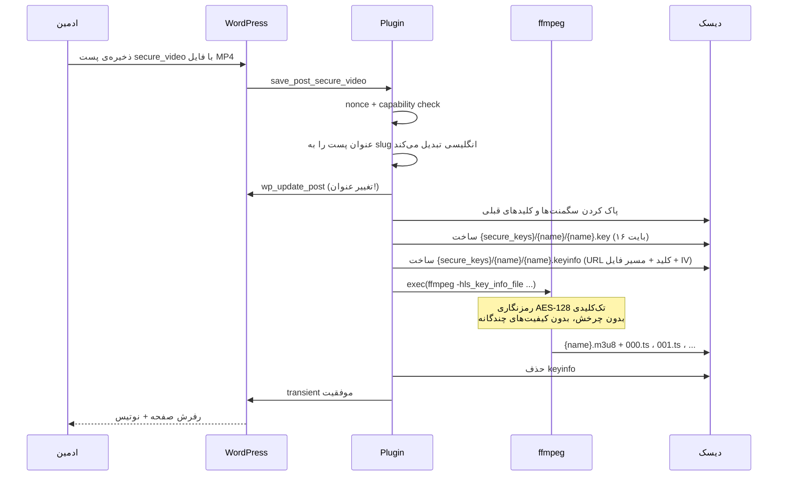
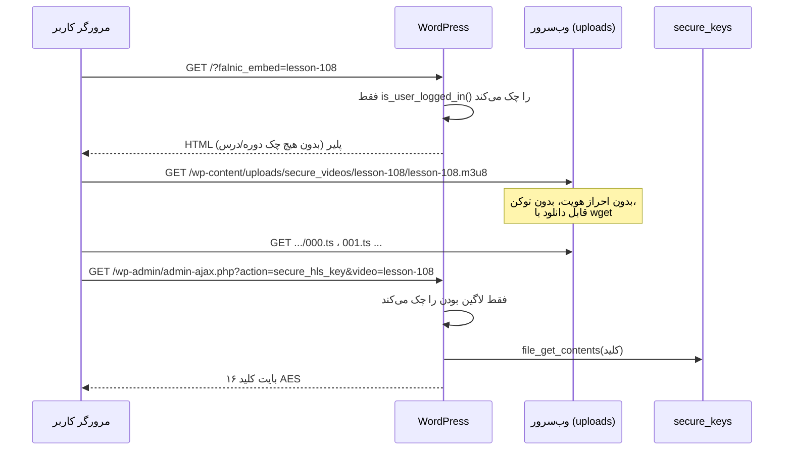
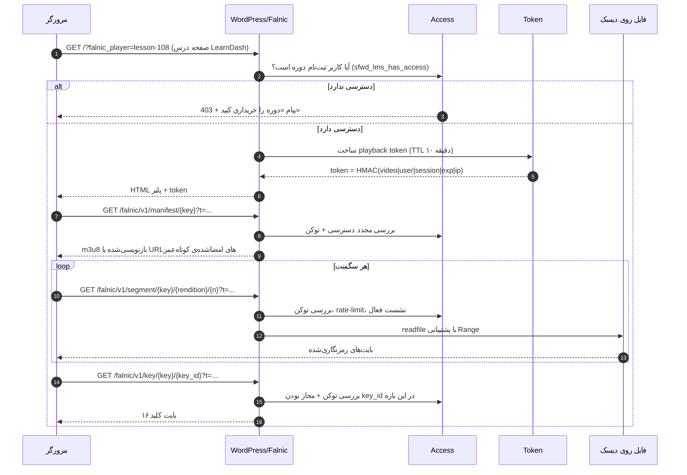

# ۰۱ — معماری

> **توجه:** بخش الف این سند کد نسخه ۳.۱.۰ (فایل واحد) را توصیف می‌کند و برای فهم ریشه‌ی مشکلات تاریخی نگه داشته شده است. ساختار فعلی (۳.۲) کلاس‌محور است و در [۱۸-ساختار](18-STRUCTURE.md) توضیح داده شده. نقشه‌ی نگاشت در انتهای همین سند آمده است.

## بخش الف: وضعیت فعلی (نسخه ۳.۱.۰)

### ۱. شکل کلی

کل پلاگین یک کلاس `final class Core` در namespace `Falnic\SecureHLS` است که با الگوی singleton ساخته می‌شود و در آخرین خط فایل فراخوانی می‌شود:

```php
// falnic-secure-hls.php:L415
Core::get_instance();
```

هیچ autoloader، هیچ پوشه‌ی جدا، هیچ تست و هیچ فایل `uninstall.php` وجود ندارد. تمام منطق در ۴۱۵ خط جمع شده است: مدیریت محتوا، آپلود، انکود، سرو کلید، چاپ HTML پلیر و کد JavaScript.

### ۲. نقشه‌ی مسئولیت‌ها

| خطوط | مسئولیت | توضیح |
|---|---|---|
| L20–L38 | سازنده و ثبت هوک‌ها | ۱۲ هوک در یک constructor |
| L48–L50 | مسیرها | پوشه‌ی کلید، پوشه‌ی ویدیو، URL ویدیو |
| L52–L61 | ثبت CPT | `secure_video` با `public => false` |
| L63–L80 | ستون‌های لیست مدیریت | نمایش شورت‌کد و لینک embed |
| L82–L107 | فرم آپلود | افزودن `enctype` و metabox آپلود |
| L109–L146 | ذخیره‌ی پست + اجرای انکود | همگام و داخل `save_post` |
| L148–L158 | نوتیس مدیریت | نمایش خطا/موفقیت از transient |
| L160–L193 | انکود ffmpeg | ساخت کلید، keyinfo، اجرای `exec` |
| L195–L258 | صفحات مدیریت | تنظیمات + انکودر دستی |
| L261–L270 | اندپوینت embed | `?falnic_embed=` در `template_redirect` |
| L272–L278 | کنترل نشست | `wp_destroy_other_sessions` |
| L280–L302 | تحویل کلید | `admin-ajax.php?action=secure_hls_key` |
| L304–L414 | رندر پلیر | HTML + CSS + JS + واترمارک canvas |

### ۳. جریان آپلود و انکود (وضعیت فعلی)



نکات مهم این جریان:

- **همگام است.** اگر ویدیو ۴۰ دقیقه باشد، درخواست HTTP تا پایان انکود باز می‌ماند. با `set_time_limit(0)` (L133) عملاً تایم‌اوت وب‌سرور یا پراکسی را رد می‌کند و کاربر صفحه‌ی خطا می‌بیند، در حالی که ffmpeg در پس‌زمینه ادامه دارد و ممکن است چند بار تکرار شود.
- **قفل ندارد.** دو ذخیره‌ی هم‌زمان = دو ffmpeg روی یک پوشه = سگمنت‌های خراب.
- **عنوان پست را بازنویسی می‌کند** (L120–L131). عنوان فارسی حذف می‌شود و به `video-{ID}` تبدیل می‌شود؛ این هم داده از دست می‌دهد و هم شورت‌کد‌های قبلی را می‌شکند.

### ۴. جریان پخش (وضعیت فعلی)



سه شکاف اصلی همین‌جا دیده می‌شود:

1. **پلی‌لیست و سگمنت‌ها عمومی‌اند** (L49–L50). رمزنگاری AES بدون محافظت از کلید بی‌فایده است، چون کلید هم با یک درخواست ساده گرفته می‌شود.
2. **کلید برای هر کاربر لاگین‌کرده و هر ویدیویی** قابل دریافت است (L280–L302). هیچ ارتباطی بین کاربر و دوره بررسی نمی‌شود.
3. **embed هیچ کنترل دسترسی‌ای ندارد** جز لاگین (L264).

### ۵. مرزهای اعتماد (Trust boundaries)

```
┌──────────────────────────── سرور ────────────────────────────┐
│  wp-admin (ادمین)  ──►  CPT secure_video  ──►  ffmpeg        │
│         │                                        │           │
│         ▼                                        ▼           │
│  secure_keys/  (خارج از web root ✔)      uploads/secure_videos/  (عمومی ✘)
│         ▲                                        ▲           │
└─────────┼────────────────────────────────────────┼───────────┘
          │ admin-ajax (فقط لاگین)                 │ HTTP عمومی
┌─────────┴────────────────────────────────────────┴───────────┐
│                        مرورگر کاربر                          │
└───────────────────────────────────────────────────────────────┘
```

تنها مرز درستی که رعایت شده، قرار دادن کلیدها خارج از `ABSPATH` است (L48). بقیه‌ی مسیرها از مرز عبور می‌کنند.

### ۶. جدول هوک‌های ثبت‌شده

| هوک | متد | نکته |
|---|---|---|
| `init` | `register_cpt` | درست |
| `wp_login` | `safe_session_control` | فقط حالت `max_sessions = 1` را مدیریت می‌کند |
| `wp_ajax_secure_hls_key` | `deliver_key` | نسخه‌ی `nopriv` ثبت نشده — یعنی مهمان‌ها کلید نمی‌گیرند (خوب)، اما هیچ چک دسترسی دیگری هم نیست |
| `secure_video` (shortcode) | `render_player` | پارامتر `name` از عنوان پست می‌آید |
| `template_redirect` | `render_embed_endpoint` | کل تم را دور می‌زند |
| `add_meta_boxes` | `add_video_meta_box` | فقط روی CPT خودش |
| `save_post_secure_video` | `save_post_video` | انکود همگام |
| `admin_menu` | `register_admin_menus` | دو زیرمنو |
| `post_edit_form_tag` | `add_enctype_to_post_form` | لازم برای آپلود |
| `manage_secure_video_posts_*` | ستون‌های لیست | درست |

هیچ هوکی برای `delete_post`، `uninstall`، `wp_enqueue_scripts` یا `rest_api_init` وجود ندارد.

### ۷. وابستگی‌های خارجی

| وابستگی | نسخه | نحوه‌ی بارگذاری | ریسک |
|---|---|---|---|
| hls.js | `@latest` (ناپین) | `cdn.jsdelivr.net` | نسخه در آینده می‌تواند بشکند؛ اگر CDN در ایران بلاک باشد پلیر مرده است |
| Plyr | 3.7.8 | `cdn.plyr.io` | بدون SRI؛ CSP را سخت می‌کند |
| ffmpeg | هر نسخه‌ای | `exec()` | مسیر ثابت `/usr/bin/ffmpeg` نیست؛ اگر در PATH نباشد خطا می‌دهد |

---

## بخش ب: معماری هدف (نسخه ۴)

### ۱. اصل حاکم

> **هیچ بایتی از ویدیو بدون یک توکن معتبر و یک بررسی دسترسی، از سرور خارج نمی‌شود.**

این جمله تنها تغییری است که کل امنیت پروژه به آن وابسته است. بقیه (واترمارک، ضدضبط، LearnDash) روی همین پایه سوار می‌شوند.

### ۲. ساختار پیشنهادی فایل‌ها

```
falnic-secure-hls/
├── falnic-secure-hls.php          # bootstrap: ثابت‌ها، autoload، فعال‌سازی
├── uninstall.php
├── includes/
│   ├── class-plugin.php           # ثبت هوک‌ها، boot
│   ├── class-storage.php          # مسیرها، قفل فایل، پاکسازی
│   ├── class-video.php            # مدل ویدیو: video_key، رندیشن‌ها، متادیتا
│   ├── class-encoder.php          # صف انکود، ffmpeg، وضعیت
│   ├── class-token.php            # ساخت/اعتبارسنجی توکن HMAC
│   ├── class-stream-controller.php# سرو manifest/سگمنت/کلید + Range
│   ├── class-access.php           # قوانین دسترسی (LearnDash، نقش، گروه)
│   ├── class-session.php          # نشست‌های فعال، heartbeat، محدودیت هم‌زمانی
│   ├── class-watermark.php        # پروفایل واترمارک، تزریق سرورساید (اختیاری)
│   ├── class-player.php           # رندر HTML/JS
│   ├── class-logger.php           # لاگ دسترسی و رخداد
│   └── class-cli.php              # wp falnic ...
├── admin/
│   ├── class-admin.php
│   └── views/{settings,videos,encoder,health}.php
├── assets/
│   ├── js/player.js               # بدون eval، بدون debugger
│   ├── js/vendor/hls.light.min.js # باندل شده و پین‌شده
│   ├── css/player.css
│   └── css/player-rtl.css
├── templates/embed.php
├── languages/fa_IR.po|.mo
└── tests/
```

### ۳. جریان هدف برای یک درخواست پخش



### ۴. تفکیک مسئولیت کلاس‌ها

| کلاس | ورودی | خروجی | چه چیزی را نمی‌داند |
|---|---|---|---|
| `Storage` | video_key | مسیر امن | دسترسی کاربر |
| `Video` | post/meta | رندیشن‌ها، مدت، وضعیت | HTTP |
| `Encoder` | فایل ورودی | سگمنت‌ها + کلیدها | مرورگر |
| `Token` | claimها | رشته‌ی امضاشده | فایل |
| `Access` | user_id + video_key | بله/خیر + دلیل | نحوه‌ی سرو |
| `Stream_Controller` | درخواست HTTP | بایت‌ها | منطق دوره |
| `Player` | video + token | HTML | فایل |
| `Logger` | رخداد | ردیف در جدول | هیچ‌چیز |

این تفکیک باعث می‌شود کنترل دسترسی در **یک** نقطه باشد؛ امروز در سه نقطه‌ی ناهماهنگ (embed، کلید، و هیچ‌جا برای سگمنت) پخش شده است.

### ۵. تغییرهای شکستنی نسخه ۴

| تغییر | اثر | مسیر مهاجرت |
|---|---|---|
| شناسه از عنوان پست به `video_key` | شورت‌کد قدیمی `[secure_video name="lesson-108"]` کار می‌کند اما به‌صورت deprecated | [16-MIGRATION](16-MIGRATION.md) |
| مسیر فایل از `uploads/secure_videos` به `wp-content/falnic-secure` | لینک‌های مستقیم قبلی باید بسته شوند | اسکریپت move + 301 به 403 |
| اندپوینت کلید از `admin-ajax.php` به REST | هر اسکریپت بیرونی که کلید می‌گرفت می‌شکند (که هدف است) | — |
| حذف `eval`/`debugger` | هیچ رفتار کاربری از دست نمی‌رود | — |

---

## پیوست ۲: نگاشت نسخه ۳.۱.۰ → ۳.۲

| بخش کد قدیم (فایل واحد) | جای جدید |
|---|---|
| L20–L38 سازنده و هوک‌ها | `includes/class-plugin.php` |
| L48–L50 مسیرها | `includes/class-storage.php` |
| L52–L80 CPT و ستون‌ها | `includes/class-post-type.php` |
| L82–L146 متاباکس و ذخیره | `includes/class-meta-box.php` |
| L160–L193 انکود ffmpeg | `includes/class-encoder.php` |
| L195–L258 صفحات مدیریت | `admin/class-admin-menu.php` + `admin/views/` |
| L261–L270 embed | `includes/class-embed.php` + `templates/embed.php` |
| L272–L278 نشست | `includes/class-session.php` |
| L280–L302 تحویل کلید | `includes/class-key-server.php` |
| L304–L414 رندر پلیر | `includes/class-player.php` + `templates/player.php` + `assets/js/player.js` |

---

## پیوست: خلاصه‌ی کد فعلی در ۱۲ خط

```text
CPT secure_video (خصوصی)
  └── آپلود MP4 → ffmpeg → AES-128 HLS در uploads/secure_videos/{title}/
        └── کلید در {ABSPATH}/../secure_keys/{title}/{title}.key
پخش:
  [secure_video name=...]  یا  /?falnic_embed=...
  └── Plyr + hls.js از CDN
        ├── m3u8 از uploads (عمومی!)
        ├── .ts ها از uploads (عمومی!)
        └── کلید از admin-ajax (فقط لاگین)
واترمارک: canvas روی ویدیوی opacity:0، فقط هنگام پخش
```
