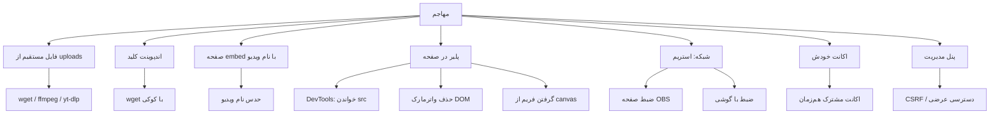

# ۰۳ — مدل تهدید

هدف این سند پاسخ به یک سؤال است: **از چه کسی، از چه راهی، و تا کجا می‌توانیم محافظت کنیم؟** بدون این پاسخ، هر تصمیم فنی حدس است.

## ۱. دارایی‌ها

| دارایی | حساسیت | اگر لو برود چه می‌شود |
|---|---|---|
| فایل ویدیوی خام (MP4 اصلی) | بسیار بالا | ارزش دوره از بین می‌رود |
| سگمنت‌های HLS | بالا | همان بالا، کمی سخت‌تر |
| کلیدهای AES | بحرانی | کل ویدیو رمزگشایی می‌شود |
| فهرست دانشجویان و ایمیل‌ها | بالا (داده‌ی شخصی) | نقض GDPR، هرزنامه |
| لاگ دسترسی | متوسط | اگر خودش لو برود، اثر انگشت رفتاری کاربران |
| اعتبارنامه‌ی ادمین | بحرانی | کل سیستم |

## ۲. بازیگران (Actors)

| بازیگر | انگیزه | توان | احتمال |
|---|---|---|---|
| **دانشجوی معمولی** | اشتراک ویدیو با دوست | کم — فقط مرورگر | زیاد |
| **دانشجوی فنی** | فروش یا انتشار ویدیو | متوسط — DevTools، `ffmpeg`، `wget` | متوسط |
| **خریدار/کاربر رایگان** | دسترسی بدون پرداخت | متوسط — شمارش URL، اکانت رایگان | متوسط |
| **رقبای تجاری** | کپی محتوا | بالا — ضبط با کارت capture، سرور | کم |
| **بات/کرالر** | جمع‌آوری محتوا | متوسط — اسکنر | متوسط |
| **فرد داخلی (ادمین/هاست)** | هر چیزی | کامل | کم اما اثر فاجعه‌بار |

**نتیجه:** بیشترین احتمال، «دانشجوی فنی» است. طراحی باید جلوی او را بگیرد و برای بقیه، حداقل **ردیابی** داشته باشد.

## ۳. سطح حمله

## ۴. تحلیل تهدیدها

### T-1 — دانلود مستقیم فایل‌های استریم
- **بازیگر:** دانشجوی فنی
- **سناریو:** `m3u8` را از HTML برمی‌دارد، با `wget -r` یا `ffmpeg -c copy` کل ویدیو را می‌سازد.
- **وضعیت فعلی:** ❌ کاملاً ممکن (F-01).
- **کاهش هدف:** فایل‌ها خارج از web root + توکن کوتاه‌عمر + محدودیت نرخ. دیگر URL ثابتی وجود ندارد.
- **باقی‌مانده:** مهاجم می‌تواند همان سگمنت‌ها را با توکن خودش هم دانلود کند. **این را نمی‌توان کامل بست**، چون مرورگر باید بتواند پخش کند. کاری که می‌کنیم: هزینه را بالا می‌بریم (توکن ۱۰ دقیقه‌ای، محدودیت ۲ نشست، لاگ) و **واترمارک** می‌گذاریم تا نشتی قابل ردیابی باشد.

### T-2 — گرفتن کلید و رمزگشایی آفلاین
- **بازیگر:** دانشجوی فنی
- **سناریو:** m3u8 + سگمنت + کلید را می‌گیرد و با `openssl` رمزگشایی می‌کند.
- **وضعیت فعلی:** ❌ با یک حساب رایگان ممکن است (F-02، F-03).
- **کاهش هدف:** کلید فقط با توکنِ متصل به کاربر و نشست، چرخش دوره‌ای کلید، محدودیت نرخ.
- **باقی‌مانده:** اگر مهاجم از یک اکانت مجاز استفاده کند، در نهایت می‌تواند کلید را بگیرد. AES-128 در HLS **جلوگیری از دانلود نیست**؛ فقط دانلودِ «بی‌زحمت» را سخت می‌کند. تنها راه واقعی جلوگیری، DRM است.

### T-3 — دسترسی به ویدیوی دوره‌ای که نخریده
- **بازیگر:** کاربر رایگان
- **سناریو:** `?falnic_embed=lesson-108` را باز می‌کند.
- **وضعیت فعلی:** ❌ با هر حساب لاگین‌کرده ممکن است (F-04).
- **کاهش هدف:** `sfwd_lms_has_access` روی همه‌ی درخواست‌ها، و بازنویسی manifest فقط برای کاربر مجاز.
- **باقی‌مانده:** تقریباً صفر، اگر بررسی در سه نقطه (رندر/manifest/کلید) یکسان باشد.

### T-4 — ضبط صفحه
- **بازیگر:** هر کسی
- **سناریو:** OBS، Xbox Game Bar، ضبط داخلی macOS، یا گوشی روی صفحه.
- **وضعیت فعلی:** ⚠️ هیچ محافظتی نیست؛ `debugger` فقط کاربر را اذیت می‌کند (F-16).
- **کاهش هدف:** **هیچ.** این تهدید فنی غیرقابل بستن است.
- **راهبرد واقعی:** **واترمارک فورنزیک** با شناسه‌ی کاربر، نشست و زمان، که در همه‌ی لایه‌ها (شامل سرورساید) باشد تا حتی ضبط‌شده هم قابل انتساب باشد. هدف از «جلوگیری» به «انتساب» تغییر می‌کند.

### T-5 — حذف واترمارک
- **بازیگر:** دانشجوی فنی
- **سناریو:** با DevTools، `canvas` را حذف می‌کند یا CSS را عوض می‌کند.
- **وضعیت فعلی:** ❌ با یک خط JS حذف می‌شود (F-20، F-21).
- **کاهش هدف:** واترمارک سرورساید (سوخته در تصویر) برای دوره‌های حساس؛ برای بقیه، واترمارک متحرک چندنقطه‌ای که حذفش نیازمند تلاش زیاد است.
- **باقی‌مانده:** واترمارک DOM همیشه قابل حذف است. اگر حذف آن برای کاربر ارزش دارد، باید سرورساید باشد.

### T-6 — اشتراک‌گذاری اکانت
- **بازیگر:** دانشجو
- **سناریو:** هم‌زمان در دو خانه پخش می‌کند.
- **وضعیت فعلی:** ❌ فقط `wp_destroy_other_sessions` در لاگین (F-23).
- **کاهش هدف:** heartbeat، محدودیت نشست هم‌زمان، اتصال به ویدیو (نه کل سایت).

### T-7 — اسکن و شمارش
- **بازیگر:** بات
- **سناریو:** نام ویدیوها را حدس می‌زند.
- **وضعیت فعلی:** ❌ نام‌ها قابل حدس‌اند (F-07) و نرخ محدود نیست (F-18).
- **کاهش:** `video_key` تصادفی + rate limit + لاگ + بلاک موقت.

### T-8 — حمله به پنل مدیریت
- **بازیگر:** مهاجم با تعامل ادمین
- **سناریو:** CSRF روی فرم تنظیمات/انکودر.
- **وضعیت فعلی:** ❌ (F-09، F-10).
- **کاهش:** nonce + capability + عدم پذیرش مسیر دلخواه.

### T-9 — افشای داده‌ی شخصی از طریق واترمارک
- **بازیگر:** هر بیننده‌ای که ویدیو را می‌گیرد
- **سناریو:** ایمیل کاربر در ویدیوی منتشرشده دیده می‌شود.
- **وضعیت فعلی:** ⚠️ ایمیل کامل چاپ می‌شود.
- **کاهش:** پیش‌فرض = «نام کاربری + بخشی از ایمیل ماسک‌شده + شناسه‌ی کوتاه نشست»؛ ایمیل کامل فقط برای دوره‌های حساس و با رضایت کاربر (سیاست GDPR). جزئیات در [۰۸](08-WATERMARKING.md#ملاحظات-حقوقی-و-حریم-خصوصی).

## ۵. ماتریس پوشش

«قبل» = نسخه ۳.۱.۰، «بعد» = هدف نسخه ۴.

| تهدید | قبل | بعد | چگونه |
|---|---|---|---|
| T-1 دانلود مستقیم | ❌ | 🟡 کاهش‌یافته | خروج از web root، توکن، rate limit |
| T-2 رمزگشایی آفلاین | ❌ | 🟡 کاهش‌یافته | توکن متصل به نشست، چرخش کلید |
| T-3 دسترسی غیرمجاز | ❌ | ✅ بسته | `sfwd_lms_has_access` در همه‌ی مسیرها |
| T-4 ضبط صفحه | ❌ | ❌ غیرقابل بستن | واترمارک فورنزیک (انتساب) |
| T-5 حذف واترمارک | ❌ | 🟡 | سرورساید برای دوره‌های حساس |
| T-6 اشتراک اکانت | ❌ | 🟡 | heartbeat + محدودیت هم‌زمان |
| T-7 اسکن/شمارش | ❌ | ✅ بسته | key تصادفی + rate limit |
| T-8 CSRF پنل | ❌ | ✅ بسته | nonce + capability |
| T-9 افشای PII | ⚠️ | ✅ بسته | ماسک ایمیل، سیاست روشن |

## ۶. چیزهایی که صریحاً قبول می‌کنیم نمی‌توانیم انجام دهیم

1. **جلوگیری از ضبط صفحه.** هیچ نرم‌افزاری نمی‌تواند OBS یا دوربین گوشی را متوقف کند. ادعای خلاف آن بازاریابی است.
2. **جلوگیری مطلق از دانلود.** پخش = دریافت بایت. تنها راه، DRM سخت‌افزاری است که در وردپرس معمولی و با بودجه‌ی محدود عملی نیست.
3. **جلوگیری از گرفتن فریم از canvas.** هر چیزی که روی صفحه رسم شود، قابل عکس‌گرفتن است.
4. **محافظت در برابر ادمین/هاست.** کسی که به فایل‌سیستم دسترسی دارد، همه‌چیز را دارد.
5. **تشخیص قطعی نشتی خودکار.** واترمارک کمک می‌کند، اما اثبات قطعی نیاز به فرآیند انسانی دارد.

## ۷. اصل راهنما

> چون **پیشگیری** محدود است، سیستم باید **بازدارندگی + انتساب** را تقویت کند:
> هر ثانیه‌ی ویدیو باید بگوید چه کسی و چه زمانی آن را دیده است.
> این تنها چیزی است که در عمل جلوی انتشار گسترده را می‌گیرد.
