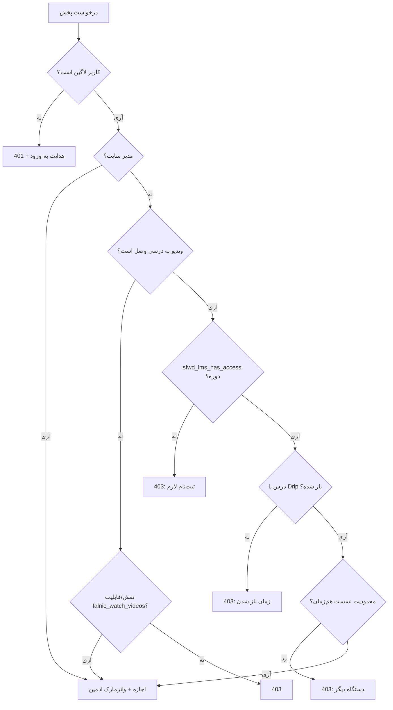

# ۰۷ — یکپارچه‌سازی LearnDash

## خلاصه

| | |
|---|---|
| وضعیت فعلی | ❌ **هیچ کدی برای LearnDash وجود ندارد** |
| آنچه هست | یک لینک `?falnic_embed=` که فقط `is_user_logged_in()` را چک می‌کند |
| هدف | متاباکس در درس/مبحث + بررسی واقعی ثبت‌نام + نمایش خودکار + احترام به Drip و گروه |

> نکته‌ی مهم: در نسخه‌ی فعلی، حتی اگر لینک embed را در درس بگذارید، **هر کاربر لاگین‌کرده‌ای** (حتی یک حساب رایگان) با حدس زدن نام ویدیو می‌تواند آن را ببیند. تا رفع [F-04](02-SECURITY-AUDIT.md#f-04) نیاز شماره ۴ برآورده نمی‌شود.

---

## ۱. مدل داده‌ی LearnDash که باید بدانیم

| موجودیت | پست‌تایپ | کلید رابطه |
|---|---|---|
| دوره | `sfwd-courses` | — |
| درس | `sfwd-lessons` | متای `course_id` |
| مبحث | `sfwd-topic` | متای `course_id` و `lesson_id` |
| آزمون | `sfwd-quiz` | `course_id` / `lesson_id` |
| گروه | `groups` | رابطه‌ی جدا |

توابع رسمی که استفاده می‌کنیم (همه در مستندات توسعه‌دهنده‌ی LearnDash آمده‌اند):

| تابع | کار |
|---|---|
| `sfwd_lms_has_access( $post_id, $user_id )` | آیا کاربر به دوره/محتوای این پست دسترسی دارد |
| `learndash_get_course_id( $id )` | شناسه‌ی دوره‌ی والد هر مرحله |
| `learndash_get_lesson_id( $post_id, $course_id )` | شناسه‌ی درس والد یک مبحث |
| `learndash_get_course_lessons_list( $course_id, $user_id )` | فهرست درس‌ها با وضعیت دسترسی |
| `learndash_get_course_steps( $course_id )` | همه‌ی مراحل دوره |
| `learndash_get_setting( $post_id )` | تنظیمات ذخیره‌شده‌ی مرحله (زمان‌بندی، نمونه بودن) |
| `ld_update_course_access( $user_id, $course_id, $remove )` | ثبت/حذف دسترسی (فقط برای تست و ابزار) |

**قاعده‌ی طلایی:** هیچ‌وقت مستقیماً به `post_meta` یا جدول‌های LearnDash دست نزنید. با افزونه‌های فروشگاه (WooCommerce, Paid Memberships, Stripe) این داده‌ها تغییر می‌کنند و تابع `sfwd_lms_has_access` همه‌ی آن‌ها را پوشش می‌دهد.

---

## ۲. مدل دسترسی



این تصمیم باید در **یک** تابع باشد و در چهار نقطه صدا زده شود: رندر HTML، manifest، سگمنت، کلید.

```php
final class Access {

    public static function can_watch( int $user_id, string $video_key ): bool {
        if ( $user_id <= 0 ) {
            return false;
        }
        if ( user_can( $user_id, 'manage_options' ) ) {
            return true;
        }

        $video = Video::find( $video_key );
        if ( ! $video || $video->status() !== 'ready' ) {
            return false;
        }

        $allowed = null;

        if ( $video->lesson_ids ) {
            if ( ! self::learndash_active() ) {
                // ویدیو به درس وصل است ولی LearnDash خاموش شده: اجازه نمی‌دهیم،
                // تا محتوای پولی به‌طور تصادفی آزاد نشود.
                $allowed = false;
            } else {
                foreach ( $video->lesson_ids as $lesson_id ) {
                    if ( self::lesson_allows( (int) $lesson_id, $user_id ) ) {
                        $allowed = true;
                        break;
                    }
                }
                $allowed ??= false;
            }
        }

        if ( $allowed === null ) {
            // ویدیوی مستقل (بدون درس)
            $allowed = user_can( $user_id, 'falnic_watch_videos' );
        }

        return (bool) apply_filters( 'falnic_can_watch', $allowed, $user_id, $video, $video->lesson_ids );
    }

    private static function lesson_allows( int $lesson_id, int $user_id ): bool {
        $course_id = (int) learndash_get_course_id( $lesson_id );
        if ( ! $course_id ) {
            return false;
        }
        if ( ! sfwd_lms_has_access( $course_id, $user_id ) ) {
            return false;
        }

        // احترام به زمان‌بندی/Drip درس، اگر LearnDash در این نسخه کمکی دارد
        if ( function_exists( 'learndash_is_lesson_not_available' )
             && learndash_is_lesson_not_available( $lesson_id, $user_id ) ) {
            return false;
        }

        // سازگاری با نسخه‌های قدیمی‌تر: خواندن تنظیمات زمان‌بندی
        $settings = (array) learndash_get_setting( $lesson_id );
        if ( ! empty( $settings['lesson_schedule'] ) && 'visible_after' === $settings['lesson_schedule'] ) {
            $days     = (int) ( $settings['visible_after'] ?? 0 );
            $enrolled = (int) get_user_meta( $user_id, 'course_' . $course_id . '_access_from', true );
            if ( $enrolled && $days > 0 && ( $enrolled + $days * DAY_IN_SECONDS ) > time() ) {
                return false;
            }
        }

        return true;
    }

    public static function deny_reason( int $user_id, string $video_key ): string {
        // برای پیام دقیق به کاربر: not_enrolled | lesson_locked | no_access
        return 'not_enrolled';
    }

    private static function learndash_active(): bool {
        return function_exists( 'sfwd_lms_has_access' );
    }
}
```

> **درباره‌ی Drip:** نام تابع کمکی بین نسخه‌های LearnDash تفاوت داشته است. کد بالا ابتدا وجود تابع را چک می‌کند و در غیر این صورت از تنظیمات مرحله استفاده می‌کند. اگر نسخه‌ی شما `learndash_is_lesson_not_available` را ندارد، همان شاخه‌ی دوم کار می‌کند. این را در [۱۴-تست](14-TESTING.md#۵-تستهای-learndash) روی نسخه‌ی نصب‌شده‌ی خودتان حتماً بررسی کنید.

---

## ۳. اتصال ویدیو به درس

### ۳.۱ متاباکس در ویرایشگر درس و مبحث

```php
add_action( 'add_meta_boxes', function ( $post_type ) {
    if ( ! in_array( $post_type, [ 'sfwd-lessons', 'sfwd-topic' ], true ) ) {
        return;
    }
    add_meta_box(
        'falnic_lesson_video',
        __( 'ویدیوی امن این درس', 'falnic-secure-hls' ),
        [ Admin::class, 'render_lesson_box' ],
        $post_type,
        'side',
        'default'
    );
} );
```

نمای متاباکس:

```
┌─────────────────────────────────────┐
│ ویدیوی امن این درس                  │
│                                     │
│ [ درس ۱۰۸ — مقدمه        ▼ ]        │
│ 🔍 جست‌وجو در ویدیوها…              │
│                                     │
│ وضعیت: ✅ آماده  | مدت: ۱۲:۳۴       │
│ [ پیش‌نمایش ]  [ حذف اتصال ]        │
│                                     │
│ ☑ نمایش خودکار بالای محتوا          │
│ واترمارک: [ پیش‌فرض ▼ ]             │
└─────────────────────────────────────┘
```

ذخیره:

```php
add_action( 'save_post_sfwd-lessons', [ Admin::class, 'save_lesson_box' ] );
add_action( 'save_post_sfwd-topic',   [ Admin::class, 'save_lesson_box' ] );

public static function save_lesson_box( int $post_id ): void {
    if ( ! isset( $_POST['falnic_lesson_nonce'] )
         || ! wp_verify_nonce( sanitize_key( $_POST['falnic_lesson_nonce'] ), 'falnic_lesson_box' ) ) {
        return;
    }
    if ( defined( 'DOING_AUTOSAVE' ) && DOING_AUTOSAVE ) {
        return;
    }
    if ( ! current_user_can( 'edit_post', $post_id ) ) {
        return;
    }

    $video_key = isset( $_POST['falnic_video_key'] )
        ? sanitize_text_field( wp_unslash( $_POST['falnic_video_key'] ) )
        : '';

    if ( $video_key && preg_match( '/^v_[a-f0-9]{16}$/', $video_key ) ) {
        update_post_meta( $post_id, '_falnic_video_key', $video_key );
        Video::add_lesson_ref( $video_key, $post_id );   // برای جست‌وجوی معکوس
    } else {
        delete_post_meta( $post_id, '_falnic_video_key' );
    }
}
```

### ۳.۲ نمایش خودکار (بدون شورت‌کد)

```php
add_filter( 'the_content', function ( $content ) {
    if ( ! is_singular( [ 'sfwd-lessons', 'sfwd-topic' ] ) ) {
        return $content;
    }
    if ( 'yes' !== get_option( 'falnic_ld_auto_embed', 'yes' ) ) {
        return $content;
    }
    if ( did_action( 'falnic_lesson_video_rendered_' . get_the_ID() ) ) {
        return $content;   // جلوگیری از دوبار چاپ
    }

    $html = Player::for_lesson( get_the_ID() );
    if ( ! $html ) {
        return $content;
    }

    do_action( 'falnic_lesson_video_rendered_' . get_the_ID() );

    return 'after' === get_option( 'falnic_ld_position', 'before' )
        ? $content . $html
        : $html . $content;
}, 20 );
```

**چرا inline و نه iframe؟** چون واترمارک canvas فقط وقتی کار می‌کند که پلیر در DOM همان صفحه باشد و بتواند به کانتینر خودش دسترسی داشته باشد. iframe در نسخه‌ی فعلی هم واترمارک را در صفحه‌ی جدا می‌سازد و هم `frame-ancestors` را پیچیده می‌کند. **پیشنهاد: inline به‌صورت پیش‌فرض** و iframe فقط برای سایت‌های بیرونی.

### ۳.۳ شورت‌کد درس جاری

```
[falnic_lesson_video]
```
هیچ پارامتری لازم ندارد؛ ویدیوی متصل به `get_the_ID()` را می‌آورد. برای استفاده در قالب:

```php
echo Player::for_lesson( get_the_ID(), [ 'autoplay' => false ] );
```

---

## ۴. سازگاری با امکانات LearnDash

| امکان | نحوه‌ی پشتیبانی |
|---|---|
| **Course Builder** | از `learndash_get_course_id()` استفاده می‌کنیم، نه متای خام؛ بنابراین با Builder کار می‌کند |
| **درس/مبحث مشترک (Shared Steps)** | ویدیو با `lesson_id` ذخیره می‌شود؛ دسترسی برای هر دوره‌ای که آن مرحله را دارد بررسی می‌شود |
| **درس نمونه (Sample Lesson)** | `sfwd_lms_has_access` برای درس نمونه `true` برمی‌گرداند؛ ما هم همان را می‌پذیریم |
| **Drip / زمان‌بندی** | بخش ۲؛ رد با پیام زمان باز شدن |
| **پیش‌نیاز درس** | اگر LearnDash دسترسی را محدود کند، ما هم محدود می‌کنیم (تابع مشترک) |
| **گروه (Groups)** | `sfwd_lms_has_access` گروه را پوشش می‌دهد |
| **WooCommerce / Paid Memberships / Stripe** | چون از همان تابع دسترسی استفاده می‌کنیم، خودکار پوشش داده می‌شود |
| **Focus Mode** | پلیر باید در قالب Focus Mode هم رندر شود؛ تست لازم است |
| **REST/App** | همان اندپوینت‌های `falnic/v1` با احراز هویت اپلیکیشن |
| **چند سایت (Multisite)** | کلیدها و لاگ‌ها per-site؛ ذخیره‌سازی مشترک با `FALNIC_STORAGE_DIR` ممکن است |

> ⚠️ **نکته‌ی مهم درباره‌ی کش:** اگر از افزونه‌ی کش صفحه استفاده می‌کنید، صفحه‌ی درس ممکن است نسخه‌ی کاربر A را به کاربر B بدهد (چون HTML شامل توکن و واترمارک است). راه‌حل: یا صفحه‌های درس را از کش مستثنی کنید، یا HTML را بدون توکن رندر کنید و توکن را با JS از `/session` بگیرید (روش پیشنهادی و در [۱۰](10-PLAYER.md) توضیح داده شده).

---

## ۵. رفتار در نبود LearnDash

پلاگین باید بدون LearnDash هم فعال شود و خطای مرگبار ندهد:

```php
register_activation_hook( __FILE__, function () {
    add_role( 'falnic_student', 'دانشجو', [ 'read' => true, 'falnic_watch_videos' => true ] );
} );
```
و در `Access::can_watch`، شاخه‌ی `learndash_active()` این را پوشش می‌دهد. در پنل، اگر LearnDash نصب نبود یک نوتیس غیرمسدودکننده نشان دهید: «LearnDash نصب نیست؛ ویدیوها فقط با نقش/قابلیت پخش می‌شوند.»

---

## ۶. چک‌لیست تست LearnDash

| # | سناریو | انتظار |
|---|---|---|
| LD-1 | دانشجوی ثبت‌نام‌کرده | پخش + واترمارک خودش |
| LD-2 | کاربر لاگین بدون ثبت‌نام | ۴۰۳ و پیام «ثبت‌نام لازم» |
| LD-3 | مهمان | ۴۰۱ و هدایت به ورود |
| LD-4 | درس با Drip فردا | پیام «از تاریخ …» و ۴۰۳ |
| LD-5 | درس نمونه، کاربر بدون ثبت‌نام | پخش (مطابق رفتار LearnDash) |
| LD-6 | دوره‌ی خریده‌شده با WooCommerce و سپس بازپرداخت | بعد از لغو دسترسی: ۴۰۳ |
| LD-7 | لغو عضویت گروه | ۴۰۳ |
| LD-8 | دو درس با یک ویدیو | هر دو پخش؛ لاگ درس درست |
| LD-9 | حذف اتصال ویدیو از درس | پیام «ویدیویی برای این درس تنظیم نشده» |
| LD-10 | غیرفعال‌کردن LearnDash | بدون Fatal error؛ نقش‌محور کار کند |
| LD-11 | Focus Mode | پلیر بدون شکستن قالب دیده شود |
| LD-12 | کش صفحه فعال | هر کاربر توکن و واترمارک خودش را بگیرد |

---

## ۷. آنچه انجام نمی‌دهیم

- بازنویسی منطق ثبت‌نام/پرداخت LearnDash.
- ساخت دوره یا درس به‌صورت خودکار.
- دسترسی به داده‌ها با SQL مستقیم.
- شمارش پیشرفت دوره (به LearnDash واگذار می‌شود؛ فقط موقعیت پخش را برای «ادامه‌ی تماشا» ذخیره می‌کنیم).
