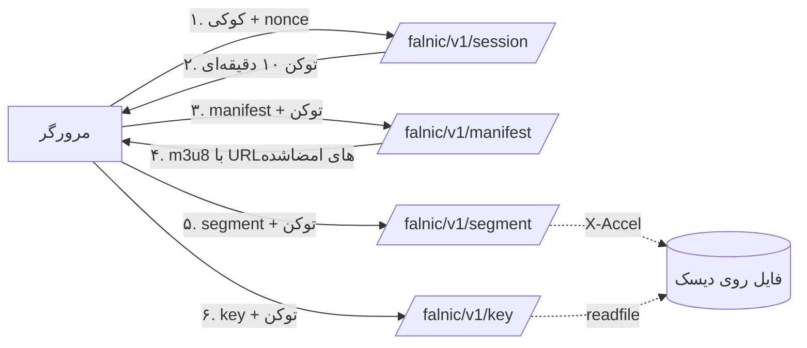

# ۰۹ — تحویل امن استریم

این مهم‌ترین سند فنی پروژه است. اگر فقط یک چیز از کل مستندات اجرا شود، این است: **هیچ فایلی بدون توکن معتبر و بررسی دسترسی از سرور خارج نشود.**

---

## ۱. اصل طراحی



سه قاعده‌ی غیرقابل‌مذاکره:

1. **مسیر فایل هرگز در HTML یا manifest به‌صورت مستقیم نمی‌آید.**
2. **هر درخواست، دوباره دسترسی کاربر را بررسی می‌کند** (نه فقط لحظه‌ی صدور توکن).
3. **نام فایل‌ها تصادفی و خارج از web root است.**

---

## ۲. محل ذخیره‌سازی

### گزینه‌ها

| گزینه | امنیت | کارایی | توصیه |
|---|---|---|---|
| `wp-content/uploads/` (فعلی) | ❌ عمومی | خوب | هرگز |
| `wp-content/falnic-secure/` + `.htaccess`/Nginx deny | 🟡 وابسته به پیکربندی | خوب | حداقل قابل قبول |
| **`dirname(ABSPATH)/falnic-secure/`** | ✅ خارج از web root | خوب | **پیش‌فرض** |
| دیسک جدا / NFS / S3 (private) | ✅ | نیاز به پروکسی | برای مقیاس |

```php
final class Storage {
    public static function root(): string {
        $dir = defined( 'FALNIC_STORAGE_DIR' )
            ? FALNIC_STORAGE_DIR
            : dirname( ABSPATH ) . '/falnic-secure';

        return trailingslashit( wp_normalize_path( $dir ) );
    }

    public static function videos(): string { return self::root() . 'videos/'; }
    public static function keys(): string   { return self::root() . 'keys/'; }

    public static function ensure(): void {
        foreach ( [ self::videos(), self::keys(), self::root() . 'incoming/', self::root() . 'tmp/' ] as $d ) {
            if ( ! is_dir( $d ) ) {
                wp_mkdir_p( $d );
                @chmod( $d, 0700 );
            }
        }
        if ( ! file_exists( self::root() . '.htaccess' ) ) {
            // باند‌اید برای وقتی که پوشه اشتباهاً داخل web root است
            file_put_contents( self::root() . '.htaccess',
                "Require all denied\n<IfModule !mod_authz_core.c>\nDeny from all\n</IfModule>\n" );
        }
        if ( ! file_exists( self::root() . 'index.php' ) ) {
            file_put_contents( self::root() . 'index.php', "<?php\n// Silence is golden.\n" );
        }
    }
}
```

> اگر چاره‌ای جز قرار دادن فایل‌ها در `wp-content` ندارید، حتماً `Nginx` را با `location ~* /falnic-secure/ { deny all; }` ببندید. `.htaccess` روی Nginx اجرا نمی‌شود — این اشتباه رایج است.

---

## ۳. توکن پخش

### ۳.۱ ساخت

```php
final class Token {

    private const VERSION = 'v1';

    public static function issue( array $claims, int $ttl ): string {
        $payload = [
            'vid' => $claims['vid'],
            'uid' => (int) $claims['uid'],
            'sid' => $claims['sid'],
            'sc'  => $claims['sc'],            // manifest | segment | key
            'kid' => $claims['kid'] ?? null,   // فقط برای scope=key
            'iat' => time(),
            'exp' => time() + $ttl,
        ];
        if ( 'yes' === get_option( 'falnic_bind_ip', 'no' ) ) {
            $payload['ip'] = self::ip_hash();
        }

        $json = wp_json_encode( $payload, JSON_UNESCAPED_SLASHES );
        $body = self::VERSION . '.' . self::b64url( $json );
        $sig  = self::b64url( hash_hmac( 'sha256', $body, self::secret(), true ) );

        return $body . '.' . $sig;
    }

    public static function verify( string $token, array $expect ): array|WP_Error {
        $parts = explode( '.', $token );
        if ( count( $parts ) !== 3 || self::VERSION !== $parts[0] ) {
            return new WP_Error( 'falnic_bad_token', '', [ 'status' => 401 ] );
        }

        $body = $parts[0] . '.' . $parts[1];
        $sig  = hash_hmac( 'sha256', $body, self::secret(), true );
        if ( ! hash_equals( $sig, self::b64url_decode( $parts[2] ) ) ) {
            return new WP_Error( 'falnic_bad_token', '', [ 'status' => 401 ] );
        }

        $claims = json_decode( self::b64url_decode( $parts[1] ), true );
        if ( ! is_array( $claims ) ) {
            return new WP_Error( 'falnic_bad_token', '', [ 'status' => 401 ] );
        }
        if ( (int) $claims['exp'] < time() ) {
            return new WP_Error( 'falnic_token_expired', '', [ 'status' => 401 ] );
        }
        if ( isset( $expect['vid'] ) && $claims['vid'] !== $expect['vid'] ) {
            return new WP_Error( 'falnic_bad_token', '', [ 'status' => 403 ] );
        }
        if ( isset( $expect['sc'] ) && $claims['sc'] !== $expect['sc'] ) {
            return new WP_Error( 'falnic_bad_token', '', [ 'status' => 403 ] );
        }
        if ( (int) $claims['uid'] !== get_current_user_id() ) {
            return new WP_Error( 'falnic_bad_token', '', [ 'status' => 403 ] );
        }
        if ( isset( $claims['ip'] ) && ! hash_equals( $claims['ip'], self::ip_hash() ) ) {
            return new WP_Error( 'falnic_bad_token', '', [ 'status' => 403 ] );
        }

        return $claims;
    }

    private static function secret(): string {
        if ( defined( 'FALNIC_TOKEN_SECRET' ) && strlen( FALNIC_TOKEN_SECRET ) >= 32 ) {
            return FALNIC_TOKEN_SECRET;
        }
        // وردپرس به‌طور پیش‌فرض کلید امنیتی دارد؛ ولی کلید اختصاصی بهتر است
        return wp_salt( 'falnic_secure_hls' );
    }

    private static function ip_hash(): string {
        $ip = $_SERVER['REMOTE_ADDR'] ?? '';
        if ( defined( 'FALNIC_TRUSTED_PROXY_HEADER' ) && ! empty( $_SERVER[ FALNIC_TRUSTED_PROXY_HEADER ] ) ) {
            $ip = sanitize_text_field( wp_unslash( $_SERVER[ FALNIC_TRUSTED_PROXY_HEADER ] ) );
        }
        return substr( hash_hmac( 'sha256', $ip, self::secret() ), 0, 16 );
    }

    private static function b64url( string $bin ): string {
        return rtrim( strtr( base64_encode( $bin ), '+/', '-_' ), '=' );
    }

    private static function b64url_decode( string $s ): string {
        return base64_decode( strtr( $s, '-_', '+/' ), true ) ?: '';
    }
}
```

<a id="۳۲-چرا-توکن-در-url-است-نه-هدر"></a>
### ۳.۲ چرا توکن در URL است، نه هدر؟

چون Safari در iOS پخش بومی HLS را انجام می‌دهد و **هدرهای سفارشی hls.js را ارسال نمی‌کند**. اگر توکن فقط در هدر باشد، کاربران آیفون ویدیو نمی‌بینند. پس توکن در query (`?t=`) می‌رود و باید:

- کوتاه‌عمر باشد (۱۰ دقیقه برای manifest، تا ۲ ساعت برای سگمنت با تمدید)،
- به `sid` و `uid` گره بخورد تا کپی‌کردن URL در مرورگر دیگر کار نکند،
- با `Referrer-Policy: no-referrer` از لو رفتن در هدر Referrer جلوگیری شود.

### ۳.۳ چرخه‌ی عمر

| رخداد | اقدام |
|---|---|
| شروع پخش | `POST /session` → توکن ۱۰ دقیقه |
| ۸ دقیقه بعد | `POST /token` تمدید (بی‌صدا) |
| توقف > ۹۰ ثانیه | نشست باطل، توکن‌ها بی‌اثر |
| بستن تب | `navigator.sendBeacon('/session/close')` |
| محدودیت دستگاه | قدیمی‌ترین نشست با `end_reason=limit` بسته می‌شود |

---

## ۴. بازنویسی Manifest

m3u8 چیزی جز متن نیست؛ در زمان درخواست می‌خوانیم، بازنویسی می‌کنیم و با `no-store` می‌فرستیم.

```php
public function serve_manifest( WP_REST_Request $req ) {
    $vid = $req['vid'];
    if ( ! preg_match( '/^v_[a-f0-9]{16}$/', $vid ) ) {
        return new WP_Error( 'falnic_bad_id', '', [ 'status' => 400 ] );
    }
    $claims = Token::verify( (string) $req['t'], [ 'vid' => $vid, 'sc' => 'manifest' ] );
    if ( is_wp_error( $claims ) ) {
        Logger::denied( 'manifest', $vid, $claims->get_error_code() );
        return $claims;
    }
    if ( ! Access::can_watch( get_current_user_id(), $vid ) ) {
        Logger::denied( 'manifest', $vid, 'not_enrolled' );
        return new WP_Error( 'falnic_not_enrolled', '…', [ 'status' => 403 ] );
    }

    $path = Storage::videos() . $vid . '/master.m3u8';
    $real = realpath( $path );
    if ( ! $real || strpos( $real, realpath( Storage::videos() ) ) !== 0 ) {
        return new WP_Error( 'falnic_video_missing', '', [ 'status' => 404 ] );
    }

    $seg_ttl   = 7200;
    $seg_token = Token::issue( [ 'vid' => $vid, 'uid' => get_current_user_id(),
        'sid' => $claims['sid'], 'sc' => 'segment' ], $seg_ttl );

    $out = [];
    // نمونه‌ی کد برای PHP 7.4؛ در ۸.۰+ می‌توانید از str_starts_with استفاده کنید
    foreach ( file( $real, FILE_IGNORE_NEW_LINES ) as $line ) {
        $line = trim( $line );

        // کلید: URI نسبی مثل "k/1" یا "1.key"
        if ( 0 === strpos( $line, '#EXT-X-KEY:' ) ) {
            $line = preg_replace_callback( '/URI="([^"]+)"/', function ( $m ) use ( $vid, $claims ) {
                $kid = preg_replace( '/[^0-9]/', '', basename( $m[1] ) ) ?: '1';
                $t   = Token::issue(
                    [ 'vid' => $vid, 'uid' => get_current_user_id(), 'sid' => $claims['sid'],
                      'sc' => 'key', 'kid' => (int) $kid ],
                    300
                );
                return 'URI="/falnic/v1/key/' . $vid . '/' . $kid . '?t=' . rawurlencode( $t ) . '"';
            }, $line );
            $out[] = $line;
            continue;
        }

        // init segment در fMP4
        if ( 0 === strpos( $line, '#EXT-X-MAP:' ) ) {
            $out[] = preg_replace_callback( '/URI="([^"]+)"/', fn() =>
                'URI="/falnic/v1/segment/' . $vid . '/init?t=' . rawurlencode( $seg_token ) . '"', $line );
            continue;
        }

        // سگمنت
        if ( '' !== $line && '#' !== $line[0] ) {
            $file = basename( $line );
            $rend = preg_match( '#^([^/]+)/#', $line, $m ) ? $m[1] : 'main';
            $n    = preg_replace( '/[^0-9]/', '', $file );
            $out[] = '/falnic/v1/segment/' . $vid . '/' . rawurlencode( $rend ) . '/' . $n
                   . '?t=' . rawurlencode( $seg_token );
            continue;
        }

        $out[] = $line;
    }

    nocache_headers();
    header( 'Content-Type: application/vnd.apple.mpegurl; charset=utf-8' );
    header( 'X-Falnic-Session: ' . preg_replace( '/[^A-Z0-9\-]/', '', $claims['sid'] ) );
    echo implode( "\n", $out );
    exit;
}
```

نکات:
- **هرگز** فایل manifest را با `file_get_contents` به‌صورت کامل در حافظه نگیرید اگر ویدیوهای بلند دارید؛ `file()` هم قابل قبول است ولی برای ۱۰۰k خط، خط‌به‌خط بخوانید.
- الگوی `preg_replace` باید تست شود؛ اگر URI سگمنت‌ها nested باشد (`720p/00001.ts`) باید rendition استخراج شود.
- `#EXT-X-SESSION-KEY` هم باید بازنویسی شود (در master برای DRM؛ در AES-128 معمولاً نیست).

---

## ۵. سرو سگمنت

### ۵.۱ مسیر سریع: Nginx `X-Accel-Redirect`

اگر PHP بخواهد ۲ مگابایت را در هر درخواست بخواند، با ۲۰۰ کاربر هم‌زمان به سقف CPU می‌خورید. راه استاندارد: PHP فقط احراز هویت می‌کند و Nginx فایل را می‌فرستد.

```php
// بعد از همه‌ی بررسی‌ها:
header( 'Accept-Ranges: bytes' );
header( 'Content-Type: video/mp2t' );
header( 'Cache-Control: private, max-age=0, no-store' );
header( 'X-Content-Type-Options: nosniff' );
header( 'X-Accel-Redirect: /falnic-internal/' . $rel_path );  // Nginx
// Apache + mod_xsendfile: header( 'X-Sendfile: ' . $abs_path );
exit;
```

```nginx
# فقط از داخل سرور قابل دسترسی است
location /falnic-internal/ {
    internal;
    alias /var/www/falnic-secure/;
    add_header Accept-Ranges bytes;
    add_header Cache-Control "private, no-store";
    types { video/mp2t ts; application/vnd.apple.mpegurl m3u8; }
}
```

`internal;` تضمین می‌کند هیچ درخواست بیرونی مستقیم به این مسیر نرسد.

### ۵.۲ با `secure_link` (بدون PHP برای هر سگمنت)

اگر بار بسیار بالاست، به‌جای پروکسی PHP از امضای Nginx استفاده کنید:

```nginx
location /falnic-media/ {
    secure_link $arg_s,$arg_e;
    secure_link_md5 "$secure_link_expires$uri$remote_addr falnic-secret";
    if ($secure_link = "") { return 403; }
    if ($secure_link = "0") { return 410; }
    alias /var/www/falnic-secure/;
}
```
در PHP:
```php
$expires = time() + 7200;
$sig = rtrim( strtr( base64_encode( md5( $expires . $uri . $ip . ' falnic-secret', true ) ), '+/', '-_' ), '=' );
$url = "/falnic-media/{$rel}?e={$expires}&s={$sig}";
```
مزیت: بدون بوت وردپرس؛ معایب: دسترسی دوباره بررسی نمی‌شود (فقط امضا)، و IP در امضا با موبایل مشکل‌ساز است.

**توصیه:** `auth_request` ترکیب امنیت و کارایی را می‌دهد:

```nginx
location = /falnic-auth {
    internal;
    include fastcgi_params;
    fastcgi_param SCRIPT_FILENAME $document_root/index.php;
    fastcgi_param QUERY_STRING "falnic_auth=1&$query_string";
    fastcgi_pass unix:/run/php/php8.2-fpm.sock;
}
location /falnic-media/ {
    auth_request /falnic-auth;
    alias /var/www/falnic-secure/;
}
```

### ۵.۳ Range و Seek

- `Accept-Ranges: bytes` همیشه ارسال شود.
- در `X-Accel-Redirect`، Nginx خودش `Range` را مدیریت می‌کند.
- در `readfile` دستی، هدر `Range` را پارس کنید و `206` + `Content-Range` بدهید؛ در غیر این صورت seek در کروم کند/شکسته می‌شود.
- سگمنت‌ها کوچک‌اند (۱۰ ثانیه، ~۳۰۰KB)؛ اگر HLS درست تنظیم شده باشد، Range کم لازم می‌شود، اما Safari برای seek گاهی درخواست Range می‌فرستد.

---

<a id="چرخش-کلید"></a>
## ۶. چرخش کلید

```bash
ffmpeg -i input.mp4 \
  -c:v libx264 -preset fast -crf 23 -g 100 -keyint_min 100 -sc_threshold 0 \
  -c:a aac -b:a 128k \
  -hls_time 10 -hls_playlist_type vod \
  -hls_flags periodic_rekey \
  -hls_key_info_file keyinfo.txt \
  -hls_segment_filename "videos/$KEY/720p/%05d.ts" \
  "videos/$KEY/720p/index.m3u8"
```

ساخت `keyinfo` با چند کلید:

```
# keyinfo.txt — هر بلوک: URI، مسیر فایل کلید، IV
k/1
/var/falnic-secure/keys/$KEY/1.key
0x... (یا خالی برای IV تصادفی)
k/2
/var/falnic-secure/keys/$KEY/2.key
k/3
/var/falnic-secure/keys/$KEY/3.key
```

سپس `index.json` بسازید که بگوید هر کلید در کدام بازه‌ی زمانی/سگمنتی است. در `serve_key` بررسی کنید `kid` با بازه‌ی مجاز همان نشست هم‌خوان باشد.

**چرا مهم است:** اگر یک کلید لو برود، فقط ۴۰ سگمنت (~۶.۵ دقیقه) قابل رمزگشایی است، نه کل ویدیو.

> هشدار: `periodic_rekey` کلید را بعد از هر `-hls_time` عوض می‌کند و به تعداد زیادی فایل کلید نیاز دارد. تعداد را با `-hls_time` و `-hls_key_info_file` متعادل کنید (مثلاً ۴۰ سگمنت = ۶.۶ دقیقه).

---

## ۷. کش

| منبع | هدر | دلیل |
|---|---|---|
| `manifest` | `no-store, private` | مخصوص هر نشست است |
| `segment` | `private, max-age=0, no-store` | با توکن در URL، کش اشتراکی می‌تواند به کاربر دیگر بدهد |
| `key` | `no-store` | حساس‌ترین |
| `player.js/css` | `public, max-age=31536000, immutable` | نسخه‌دار (`?ver=`) |
| صفحه‌ی درس | باید از کش صفحه مستثنی شود یا HTML بدون توکن باشد | وگرنه واترمارک/توکن کاربر A به B می‌رسد |

<a id="cdn"></a>
اگر از CDN استفاده می‌کنید:
- سگمنت‌ها را **با کلید توکن در URL** کش کنید، نه با `no-store`؛ یعنی امضا در لبه (edge) بررسی شود (Cloudflare Signed URLs / Token Authentication).
- `Cache-Control` را برای سگمنت به `private` تغییر ندهید اگر لبه امضا را چک می‌کند؛ در این حالت `public, max-age=3600` با URL امضاشده‌ی یکتا ترکیب می‌شود و هر توکن کش جدا دارد. این کار مصرف کش را زیاد می‌کند؛ برای سایت کوچک ارزش ندارد.

---

## ۸. محدودیت نرخ

| منبع | سقف پیش‌فرض | عمل |
|---|---|---|
| `segment` | ۶۰/دقیقه/نشست | `429` + `Retry-After: 5` |
| `key` | ۱۰/دقیقه/کاربر | `429` + لاگ |
| `session` | ۵/دقیقه/کاربر | `429` |
| `manifest` | ۲۰/دقیقه/نشست | `429` |
| تلاش ناموفق (۴۰۳/۴۰۱) | ۲۰/۵دقیقه/IP | بلاک موقت ۱۵ دقیقه |

پیاده‌سازی: شمارنده در جدول `falnic_rate` یا transient با کلید `falnic_rl_{scope}_{hash}` و `wp_cache`/Redis. برای چند سرور، Redis الزامی است.

---

## ۹. کارایی و مقیاس

| مورد | عدد تقریبی |
|---|---|
| سربار وردپرس برای یک سگمنت | ۳۰–۶۰ms (بدون کش آبجکت) |
| با `X-Accel-Redirect` | ۵–۱۵ms PHP + انتقال فایل توسط Nginx |
| با `auth_request` | ۲–۵ms (کش‌شده) |
| پهنای باند ۲۰۰ کاربر ۷۲۰p | ≈ ۵۰۰Mbps |
| فضای یک ویدیوی ۱ ساعته ۷۲۰p | ≈ ۱.۲GB |
| هر ۱۰۰۰ سگمنت | ≈ ۱ فایل index + ۱۰۰۰ فایل کوچک |

توصیه‌های عملی:
- `hls_time` بین ۶ تا ۱۰ ثانیه (کمتر = فایل‌های بیشتر).
- فایل‌سیستم با `noatime`.
- `opcache` و object cache فعال.
- برای بیش از ۳۰۰ هم‌زمان، CDN یا سرور رسانه‌ی جدا.

---

## ۱۰. استراتژی چند کیفیت

```
master.m3u8
├── #EXT-X-STREAM-INF:BANDWIDTH=800000,RESOLUTION=640x360  360p/index.m3u8
├── #EXT-X-STREAM-INF:BANDWIDTH=1600000,RESOLUTION=1280x720 720p/index.m3u8
└── #EXT-X-STREAM-INF:BANDWIDTH=3000000,RESOLUTION=1920x1080 1080p/index.m3u8
```
هر rendition کلید و manifest جدا دارد؛ بازنویسی باید برای master و هر دو سطح انجام شود. مزیت امنیتی: هیچ‌کدام از فایل‌ها نام قابل حدس ندارند.

---

## ۱۱. خطاها

| سناریو | پاسخ | رفتار پلیر |
|---|---|---|
| توکن منقضی | `401 falnic_token_expired` | تمدید خودکار و ادامه |
| دسترسی لغو شد (بازپرداخت) | `403 falnic_not_enrolled` | توقف + پیام |
| محدودیت دستگاه | `403 falnic_session_limit` | پیام «دستگاه دیگر» |
| فایل گم شد | `404 falnic_video_missing` | پیام + لاگ خطا |
| rate limit | `429` | تلاش مجدد با backoff |

هیچ‌گاه صفحه‌ی HTML در پاسخ باینری برنگردانید؛ hls.js فقط کد وضعیت را می‌فهمد و صفحه سیاه می‌شود ([۱۰](10-PLAYER.md#خطاها)).

---

## ۱۲. چک‌لیست پذیرش

- [ ] `curl` به مسیر `uploads/secure_videos` → `404/403`
- [ ] `curl` به `/falnic-media/...` مستقیم → `403`
- [ ] manifest بدون توکن → `401`
- [ ] manifest با توکن کاربر دیگر → `403`
- [ ] سگمنت با توکن منقضی → `401`
- [ ] `Range: bytes=0-99` → `206` + `Content-Range`
- [ ] کلید `kid` خارج از بازه → `403`
- [ ] ۶۱ درخواست سگمنت در دقیقه → `429`
- [ ] لغو دسترسی در LearnDash → درخواست بعدی `403`
- [ ] اجرای `yt-dlp` روی صفحه → شکست
- [ ] ۵۰ پخش هم‌زمان بدون خطای ۵۰۲
