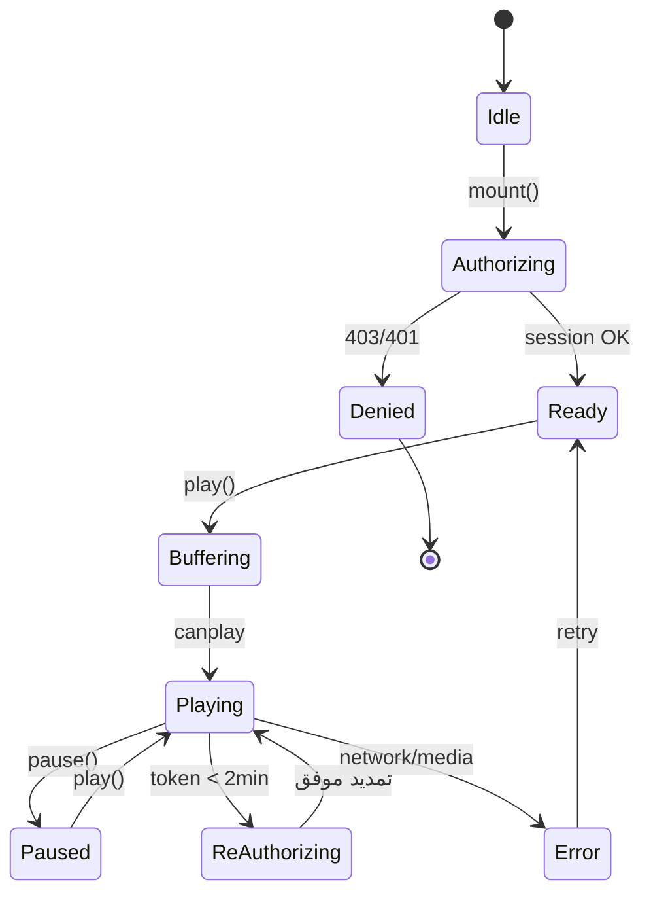

# ۱۰ — پلیر سمت مرورگر

## ۱. اصول

| اصل | نتیجه |
|---|---|
| بدون `eval`، بدون `debugger`، بدون دستکاری `document.body` | CSP سخت‌گیرانه ممکن، تجربه‌ی کاربر سالم |
| دارایی‌ها محلی و پین‌شده | پلیر در ایران و پشت فایروال هم کار می‌کند |
| پیکربندی با `wp_add_inline_script` نه رشته‌سازی HTML | بدون تزریق، بدون `esc_js` |
| هر نمونه مستقل | چند ویدیو در یک صفحه بدون تعارض |
| خطاها قابل نمایش | کاربر هرگز صفحه‌ی سیاه بی‌دلیل نمی‌بیند |
| دسترس‌پذیر | کیبورد، صفحه‌خوان، زیرنویس |

---

## ۱.۱. وضعیت پیاده‌شده (۳.۳)

پیکربندی واقعی که به `assets/js/player.js` می‌رسد این شکل است:

```json
{
  "id": "secure-vid-1",
  "name": "lesson-108",
  "sessionUrl": "https://example.com/wp-admin/admin-ajax.php?action=falnic_stream_session",
  "heartbeatUrl": "https://example.com/wp-admin/admin-ajax.php?action=falnic_stream_heartbeat",
  "endUrl": "https://example.com/wp-admin/admin-ajax.php?action=falnic_stream_end",
  "watermark": { "line1": "", "line2": "", "opacity": 0.18, "interval": 3000, "scale": 1 },
  "i18n": { "resume": "…", "error": "…", "unsupported": "…", "sessionError": "…", "expired": "…", "sessionEnded": "…", "multiDevice": "…" }
}
```

- **هیچ `src`، توکن یا متنی از کاربر در HTML نیست.** فقط `name` و آدرس اندپوینت نشست.
- `player.js` با `POST` به `sessionUrl` می‌رود؛ پاسخ شامل `src` امضاشده، `expires` و خطوط واترمارک همان کاربر است.
- **ضربان نشست:** هر ۳۰ ثانیه `heartbeatUrl` با `sid` و توکن ضربان فراخوانی می‌شود. اگر پاسخ `alive=false` باشد (پخش از دستگاه دیگر یا «قطع پخش» مدیر)، پخش متوقف و پیام فارسی نشان داده می‌شود. با `pagehide`/`beforeunload` یک `sendBeacon` به `endUrl` می‌رود تا نشست فوری آزاد شود.
- **زیرنویس:** پاسخ نشست آرایه‌ی `subtitles` را می‌دهد؛ پلیر برای هر مورد یک `<track kind="captions" data-falnic>` می‌سازد (بدون HTML خام).
- **کیفیت:** پلیر `master.m3u8` را می‌گیرد؛ منوی کیفیت hls.js از پله‌های ساخته‌شده پر می‌شود و در DevTools هم می‌توان `f=720p/index.m3u8` را دید — هر دو مسیر توکن می‌خواهند.
- بخش ۴ این سند (پایین) طراحی اولیه بر پایه‌ی REST است؛ پیاده‌سازی نهایی به دلیل سازگاری با کش و `admin-ajax` از همان الگو ولی با اکشن‌های `falnic_stream_*` استفاده می‌کند ([۰۶](06-API.md)).

---

## ۲. پشته

| لایه | انتخاب | دلیل |
|---|---|---|
| HLS | `hls.js 1.5.17` باندل محلی (`assets/vendor/hls/`) | پشتیبانی از MSE، کنترل خطا، جایگزین بومی برای Safari — **بدون CDN** |
| کنترل‌ها | Plyr (نسخه‌ی محلی) یا کنترل سفارشی | Plyr آشنا و کامل؛ اگر CSP مسئله داشت، سفارشی |
| رندر تصویر | `<canvas>` با ترکیب واترمارک | [۰۸](08-WATERMARKING.md) |
| واترمارک | لایه‌ی canvas + شناسه‌ی نشست از API | مقاوم‌تر از overlay |

> **وضعیت در ۳.۲:** Plyr و hls.js به‌صورت محلی در `assets/vendor/` باندل شده‌اند و بارگذاری از CDN کاملاً حذف شده است. اگر روزی خواستید وابستگی را کم کنید، کنترل‌های بومی HTML5 + دکمه‌های سفارشی کافی است. تصمیم در [ADR-006](17-ADR.md#adr-006).

---

## ۳. چرخه‌ی عمر



---

## ۴. راه‌اندازی

### ۴.۱ سمت PHP (فقط پیکربندی، بدون توکن)

```php
wp_enqueue_style( 'falnic-player', FALNIC_URL . 'assets/css/player.css', [], FALNIC_VERSION );
wp_enqueue_script( 'falnic-hls', FALNIC_URL . 'assets/js/vendor/hls.light.min.js', [], '1.5.17', true );
wp_enqueue_script( 'falnic-player', FALNIC_URL . 'assets/js/player.js', [ 'falnic-hls' ], FALNIC_VERSION, true );

wp_localize_script( 'falnic-player', 'FalnicConfig', [
    'rest'    => esc_url_raw( rest_url( 'falnic/v1/' ) ),
    'nonce'   => wp_create_nonce( 'wp_rest' ),
    'postId'  => get_the_ID(),
    'i18n'    => [
        'denied'  => __( 'برای تماشای این ویدیو باید در دوره ثبت‌نام کنید.', 'falnic-secure-hls' ),
        'expired' => __( 'نشست منقضی شد؛ صفحه را دوباره باز کنید.', 'falnic-secure-hls' ),
        'offline' => __( 'اتصال اینترنت قطع است.', 'falnic-secure-hls' ),
    ],
] );
```

مزیت مهم: **HTML صفحه شامل توکن یا ایمیل کاربر نیست** → با کش صفحه سازگار است و اطلاعات کاربر در HTML لو نمی‌رود.

### ۴.۲ سمت JS

```js
const root = document.querySelector('[data-falnic-player]');
const video = root.querySelector('video');

async function start() {
  const res = await fetch(FalnicConfig.rest + 'session', {
    method: 'POST',
    credentials: 'same-origin',
    headers: { 'Content-Type': 'application/json', 'X-WP-Nonce': FalnicConfig.nonce },
    body: JSON.stringify({ post_id: FalnicConfig.postId })
  });

  if (!res.ok) {
    const err = await res.json().catch(() => ({}));
    return showError(root, err.code);
  }

  const { token, manifest_url, watermark, expires_in } = await res.json();
  mountPlayer({ root, video, token, manifest_url, watermark, expires_in });
}
start();
```

---

## ۵. پیکربندی hls.js

```js
const hls = new Hls({
  maxBufferLength: 30,
  maxMaxBufferLength: 60,
  enableWorker: true,
  lowLatencyMode: false,
  xhrSetup(xhr, url) {
    // توکن در URL است (برای Safari)، ولی هدر هم می‌فرستیم
    xhr.setRequestHeader('X-Falnic-Token', currentToken);
  }
});
```

مدیریت خطا:

```js
hls.on(Hls.Events.ERROR, (_, data) => {
  if (!data.fatal) return;
  switch (data.type) {
    case Hls.ErrorTypes.NETWORK_ERROR:
      if (data.response?.code === 401) return refreshToken().then(() => hls.startLoad());
      if (data.response?.code === 403) return showError(root, 'denied');
      if (data.response?.code === 429) return setTimeout(() => hls.startLoad(), 3000);
      hls.startLoad();
      break;
    case Hls.ErrorTypes.MEDIA_ERROR:
      hls.recoverMediaError();
      break;
    default:
      showError(root, 'fatal');
  }
});
```

---

<a id="خطاها"></a>
## ۶. خطاها

| کد | پیام به کاربر | اقدام پلیر |
|---|---|---|
| `falnic_auth_required` | «برای تماشا وارد شوید» + دکمه‌ی ورود | توقف |
| `falnic_not_enrolled` | «این ویدیو مخصوص دانشجویان دوره است» + لینک دوره | توقف |
| `falnic_lesson_locked` | «این درس از تاریخ … باز می‌شود» | توقف |
| `falnic_session_limit` | «این حساب روی دستگاه دیگری پخش می‌شود» + دکمه‌ی «ادامه در این دستگاه» | توقف |
| `falnic_not_ready` | «ویدیو در حال آماده‌سازی است» | تلاش مجدد بعد از ۳۰s |
| `falnic_token_expired` | بی‌صدا تمدید | ادامه |
| شبکه | «اتصال قطع شد» + retry | تلاش مجدد خودکار |
| CDN/اسکریپت | «پلیر بارگذاری نشد» | پیام، نه صفحه‌ی سیاه |

هیچ‌گاه `wp_die` HTML در پاسخ‌های باینری؛ همیشه JSON.

---

## ۷. موبایل و فول‌اسکرین

| مشکل | راه‌حل |
|---|---|
| iOS فول‌اسکرین بومی را جای canvas می‌آورد | `playsinline` + `root.requestFullscreen()` (iOS 16.4+). برای نسخه‌های قدیمی، دکمه‌ی فول‌اسکرین مخفی یا هشدار |
| کاربرگ `dblclick` روی موبایل | دکمه‌ی اختصاصی فول‌اسکرین |
| چرخش صفحه | `screen.orientation.lock` اختیاری؛ فقط اگر پلیر فول‌اسکرین است |
| Safe area آیفون | `padding: env(safe-area-inset-*)` |
| صرفه‌جویی باتری | `requestVideoFrameCallback` + رسم با رزولوشن نمایش |
| قطع اتصال | نمایش `offline` و تلاش مجدد با backoff |

---

## ۸. دسترس‌پذیری

- `<video>` همیشه در DOM می‌ماند (فقط `opacity: 0`) تا صفحه‌خوان آن را ببیند؛ `aria-label` توصیفی داشته باشد.
- همه‌ی دکمه‌ها `tabindex` طبیعی و `:focus-visible` واضح.
- زیرنویس با `<track kind="captions">`؛ زیرنویس روی canvas **کشیده نشود**.
- `prefers-reduced-motion`: جابه‌جایی واترمارک کندتر شود، نه حذف.
- کنتراست متن کنترل‌ها حداقل ۴.۵:۱.
- کلیدهای میان‌بر: Space پخش/توقف، ←/→ ۵ ثانیه، ↑/↓ صدا، M بی‌صدا، F فول‌اسکرین، C زیرنویس.

---

## ۹. امنیت سمت کلاینت

| کار | چرا |
|---|---|
| `controlsList="nodownload noplaybackrate"` (بدون noplaybackrate اگر لازم است) | حذف دکمه‌ی دانلود |
| `disablePictureInPicture` | جلوگیری از پنجره‌ی شناور قابل ضبط جدا |
| `disableRemotePlayback` | جلوگیری از Cast |
| `oncontextmenu="return false"` | بازدارنده |
| `draggable="false"` | جلوگیری از کشیدن ویدیو |
| `autoplay` خاموش | جلوگیری از مصرف بی‌اجازه‌ی پهنای باند |
| نبود آدرس در `src` | فقط `blob:` از MSE |
| `referrerpolicy="no-referrer"` | جلوگیری از لو رفتن URL |
| `crossorigin` فقط اگر لازم است | در MSE لازم نیست و می‌تواند canvas را taint کند |

**آنچه انجام نمی‌دهیم:** `eval`، `debugger`، بازنویسی `body`، تشخیص DevTools، بستن کلیک راست به‌عنوان «امنیت». این‌ها بازدارنده‌ی نمایشی‌اند و فقط کاربر واقعی را آزار می‌دهند ([F-16](02-SECURITY-AUDIT.md#f-16)).

---

## ۱۰. CSP و هدرها

```
Content-Security-Policy:
  default-src 'self';
  script-src 'self';
  style-src 'self' 'unsafe-inline';
  img-src 'self' data: blob:;
  media-src 'self' blob:;
  connect-src 'self';
  font-src 'self';
  frame-ancestors 'self';
  base-uri 'self';
```
- `script-src 'self'` بدون `unsafe-eval` → یعنی کد فعلی (`eval(atob())`) **باید** حذف شود.
- `media-src blob:` برای MSE لازم است.
- اگر از CDN استفاده می‌کنید، دامنه را اضافه کنید و SRI بگذارید.

---

## ۱۱. کارایی

| معیار | هدف |
|---|---|
| حجم JS پلیر (gzip) | < ۹۰KB (hls.light ~ ۵۰KB + پلیر) |
| زمان تا اولین فریم | < ۲ ثانیه |
| فریم‌های افتاده در ۷۲۰p | < ۱٪ روی لپ‌تاپ میان‌رده |
| رسم canvas | فقط با فریم جدید واتدیو |
| بارگذاری تنبل | `loading` پلیر فقط وقتی در viewport است |

---

## ۱۲. چک‌لیست تست پلیر

| # | تست | انتظار |
|---|---|---|
| PL-1 | Chrome دسکتاپ | پخش، کیفیت، فول‌اسکرین، زیرنویس |
| PL-2 | Safari دسکتاپ | پخش بومی یا MSE |
| PL-3 | iPhone Safari 16.4+ | پخش inline، فول‌اسکرین کانتینر، واترمارک دیده شود |
| PL-4 | Android Chrome | پخش، چرخش، بدون شکستن layout |
| PL-5 | دو پلیر در یک صفحه | هر دو مستقل کار کنند |
| PL-6 | قطع اینترنت وسط پخش | پیام + ادامه‌ی خودکار پس از اتصال |
| PL-7 | انقضای توکن | تمدید بی‌صدا بدون قطع تصویر |
| PL-8 | لغو دسترسی حین پخش | توقف با پیام روشن |
| PL-9 | CSP سخت‌گیرانه | بدون خطای کنسول |
| PL-10 | کیبورد تنها | همه‌ی کنترل‌ها قابل دسترسی |
| PL-11 | حالت تاریک قالب | پلیر خوانا |
| PL-12 | RTL | کنترل‌ها و متن درست |
