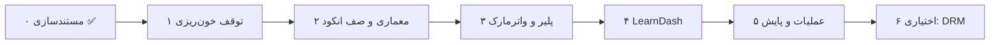

# ۱۳ — نقشه راه

## اصل حاکم

> تا فایل‌ها از مسیر عمومی سرو می‌شوند، هیچ‌کدام از نیازهای ۲، ۳ و ۴ ارزشی ندارند.
> **ترتیب: پایه → پلیر → LearnDash → واترمارک پیشرفته.**

اگر از LearnDash یا واترمارک شروع کنیم، کار جذاب‌تری است اما روی پی باطل ساخته می‌شود.

---

## فاز ۰ — مستندسازی ✅ انجام‌شده

| خروجی | وضعیت |
|---|---|
| ممیزی امنیتی با ۳۴ یافته | ✅ |
| مدل تهدید و معیارهای پذیرش | ✅ |
| طراحی هدف برای چهار نیاز | ✅ |
| نقشه‌ی مهاجرت | ✅ |

---

## فاز ۱ — توقف خون‌ریزی (نسخه ۳.۲)

**هدف:** بستن P0 ها با حداقل تغییر. **زمان:** ۲ تا ۳ روز. **ریسک:** کم.

| # | کار | یافته | معیار پذیرش |
|---|---|---|---|
| 1.1 | انتقال رسانه به `dirname(ABSPATH)/falnic-secure` + `.htaccess` محافظ | F-01 | `curl` به مسیر قدیمی `403` می‌دهد |
| 1.2 | حذف/مسدود کردن پوشه‌ی `uploads/secure_videos` | F-01 | فایل قدیمی از وب قابل خواندن نیست |
| 1.3 | افزودن `video_key` تصادفی به متا و استفاده از آن در مسیرها | F-07 | نام پوشه `v_…` است، نه عنوان |
| 1.4 | اعتبارسنجی سخت‌گیرانه شناسه + `realpath` | F-05 | `?video=../x` → `400` |
| 1.5 | بررسی دسترسی در `deliver_key` (حتی اگر فعلاً ساده: بر اساس نقش) | F-02 | کاربر رایگان `403` می‌گیرد |
| 1.6 | سرو سگمنت از طریق یک اندپوینت با توکن HMAC | F-01، F-03 | بدون توکن `401` |
| 1.7 | حذف `eval`، `debugger`، بازنویسی `body` | F-16 | `grep -E 'eval|debugger'` خالی است |
| 1.8 | `wp_json_encode` برای داده‌های کاربر در JS | F-19 | نام شامل `</script>` خطا نمی‌دهد |
| 1.9 | nonce در تنظیمات و انکودر | F-09، F-10 | درخواست بدون nonce رد می‌شود |
| 1.10 | حذف بازنویسی عنوان پست | F-11 | عنوان فارسی پس از ذخیره سالم است |
| 1.11 | `chmod 0600` کلید + پاکسازی `keyinfo` با `finally` | F-06، F-08 | مجوز فایل درست؛ فایل یتیم نیست |

**معیار خروج فاز:** هیچ یافته‌ی P0 باز نباشد + اسکریپت تست امنیتی [۱۴](14-TESTING.md#۳-تستهای-امنیتی-قابل-اجرا) پاس شود.

> در این فاز **معماری را کامل بازنویسی نمی‌کنیم** تا سایت از کار نیفتد. تغییرها افزایشی‌اند.

---

## فاز ۲ — معماری و صف انکود (نسخه ۳.۳)

**هدف:** جدا کردن مسئولیت‌ها، حذف انکود همگام، چند کیفیت. **زمان:** ۱ تا ۲ هفته.

| # | کار | معیار پذیرش |
|---|---|---|
| 2.1 | شکستن فایل به کلاس‌ها (`Storage`, `Video`, `Encoder`, `Token`, `Access`, `Stream`, `Logger`) | هیچ فایل بیش از ۳۰۰ خط؛ autoload کار می‌کند |
| 2.2 | صف انکود (Action Scheduler یا جدول اختصاصی) + وضعیت در متا | ذخیره‌ی پست فوراً برمی‌گردد؛ وضعیت در پنل زنده است |
| 2.3 | قفل `flock` روی هر ویدیو | دو انکود هم‌زمان ممکن نیست |
| 2.4 | پشتیبانی چند کیفیت (۳۶۰/۷۲۰/۱۰۸۰) + master playlist | سوییچ کیفیت در پلیر کار می‌کند |
| 2.5 | چرخش کلید (`periodic_rekey`) + `keys/index.json` | کلید دوم در نیمه‌ی ویدیو استفاده می‌شود |
| 2.6 | صفحه‌ی «سلامت سیستم» | بررسی ffmpeg، پوشه‌ها، کلید، HTTPS |
| 2.7 | پاکسازی هنگام حذف پست + `uninstall.php` | حذف ویدیو، فایل و کلید را پاک می‌کند |
| 2.8 | i18n کامل + text domain | همه‌ی رشته‌ها قابل ترجمه |
| 2.9 | `wp_enqueue` برای دارایی‌ها + باندل محلی hls.js/Plyr | هیچ CDN اجباری نیست |
| 2.10 | WP-CLI (`encode`, `health`, `cleanup`) | دستورها بدون خطا اجرا می‌شوند |
| 2.11 | مهاجرت خودکار از ۳.۲ | `wp falnic migrate --dry-run` گزارش درست می‌دهد |

**معیار خروج:** آپلود ۱GB بدون تایم‌اوت؛ انکود در پس‌زمینه؛ سه کیفیت؛ هیچ یافته‌ی P1 باز.

---

## فاز ۳ — پلیر و واترمارک (نسخه ۳.۴)

**هدف:** برآورده کردن نیاز ۲ و بهبود ۳. **زمان:** ۱ هفته.

| # | کار | معیار پذیرش |
|---|---|---|
| 3.1 | بازنویسی خط لوله‌ی canvas (بدون eval، بازسازی در seek/pause) | WM-1 تا WM-4 پاس |
| 3.2 | واترمارک شامل نام + ایمیل ماسک‌شده + شناسه‌ی نشست + زمان | WM-8 پاس |
| 3.3 | فول‌اسکرین کانتینر برای موبایل | WM-5 پاس |
| 3.4 | نشست‌ها: heartbeat، محدودیت هم‌زمان، بستن خودکار | R3.1 تا R3.3 پاس |
| 3.5 | جدول لاگ دسترسی + گزارش در پنل | جست‌وجوی `S-XXXX` نتیجه می‌دهد |
| 3.6 | rate limit روی سگمنت/کلید/نشست | ۶۱ درخواست → `429` |
| 3.7 | صفحه‌های خطای پلیر (بدون صفحه‌ی سیاه) | PL-6، PL-8 پاس |
| 3.8 | دسترس‌پذیری (کیبورد، زیرنویس، aria) | PL-10 پاس |
| 3.9 | CSP سخت‌گیرانه بدون `unsafe-eval` | PL-9 پاس |

**معیار خروج:** واترمارک در همه‌ی حالت‌ها؛ نشست‌ها کار می‌کنند؛ ضبط صفحه در فایل ضبط‌شده شامل واترمارک است (WM-10).

---

## فاز ۴ — LearnDash (نسخه ۳.۵)

**هدف:** برآوردن نیاز ۴ به‌صورت واقعی. **زمان:** ۱ هفته.

| # | کار | معیار پذیرش |
|---|---|---|
| 4.1 | متاباکس در `sfwd-lessons` و `sfwd-topic` با جست‌وجوی ویدیو | انتخاب و ذخیره کار می‌کند |
| 4.2 | نمایش خودکار در محتوا (قابل خاموش کردن) | LD-1 پاس |
| 4.3 | شورت‌کد `[falnic_lesson_video]` | بدون پارامتر کار می‌کند |
| 4.4 | `Access::can_watch` با `sfwd_lms_has_access` در هر چهار مسیر | LD-2 تا LD-7 پاس |
| 4.5 | پشتیبانی Drip و درس نمونه | LD-4، LD-5 پاس |
| 4.6 | رفتار صحیح بدون LearnDash | LD-10 پاس |
| 4.7 | سازگاری Focus Mode و Course Builder | LD-11 پاس |
| 4.8 | مستندسازی استثنای کش صفحه | LD-12 پاس |

**معیار خروج:** هیچ کاربر غیرثبت‌نام‌کرده‌ای به هیچ ویدیوی درسی دسترسی ندارد.

---

## فاز ۵ — عملیات و پایش (نسخه ۴.۰)

| # | کار | معیار |
|---|---|---|
| 5.1 | داشبورد آمار پخش (روزانه، کاربر، ویدیو) | گزارش معنی‌دار |
| 5.2 | هشدار نشتی (حذف canvas، درخواست‌های ۴۰۳ زیاد) | ایمیل/وبهوک |
| 5.3 | پاکسازی خودکار لاگ و نشست | DB رشد بی‌کنترل ندارد |
| 5.4 | پشتیبانی S3/دیسک خارجی | ویدیو از S3 با URL امضاشده |
| 5.5 | X-AccelRedirect / `auth_request` برای کارایی | ۲۰۰ هم‌زمان بدون ۵۰۲ |
| 5.6 | آزمون بار و بهینه‌سازی | NFR-2 پاس |
| 5.7 | A/B واترمارک فورنزیک (اختیاری) | تشخیص منبع در تست |

---

## فاز ۶ — خارج از دامنه (آینده)

| موضوع | چه زمانی |
|---|---|
| DRM (Widevine/FairPlay) | فقط اگر دوره‌ها ارزش بسیار بالا و بودجه‌ی سرویس DRM باشد |
| اپلیکیشن موبایل | در صورت نیاز به پخش آفلاین |
| ترجمه/زیرنویس خودکار | مستقل از امنیت |
| پخش زنده | معماری متفاوت |

---

## بک‌لاگ (ایده‌های ثبت‌شده، بدون زمان‌بندی)

- امضای URL با Cloudflare Workers
- پشتیبانی از `fMP4` به‌جای `ts` (حجم کمتر، seek بهتر)
- زیرنویس چندزبانه با ترک جداگانه
- ادامه‌ی تماشا بین دستگاه‌ها
- گزارش «کدام دانشجو کدام قسمت را دیده»
- تشخیص واترمارک در ویدیوی پیدا‌شده (نیمه‌خودکار)
- اعلان تلگرام برای نشتی مشکوک

---

## تخمین کلی

| فاز | زمان | خروجی قابل استفاده |
|---|---|---|
| ۱ | ۲–۳ روز | سایت امن‌تر، نیاز ۱ برآورده |
| ۲ | ۱–۲ هفته | پایداری و مقیاس |
| ۳ | ۱ هفته | نیاز ۲ و بهبود ۳ |
| ۴ | ۱ هفته | نیاز ۴ |
| ۵ | ۳–۵ روز | پایش و مقیاس |

**حداقل مسیر تا «قابل انتشار تجاری»:** فاز ۱ + ۴ (حدود ۱۰ روز کاری).

---

## چه کاری را اول نکنیم

| وسوسه | چرا اشتباه است |
|---|---|
| شروع با واترمارک پیشرفته | روی مسیر عمومی بی‌اثر است |
| شروع با LearnDash | با URL عمومی، محدودیت دور زده می‌شود |
| اضافه کردن `debugger` بیشتر | کاربر را می‌راند، مهاجم را نه |
| اضافه کردن DRM | هزینه‌ی زیاد پیش از رفع باگ‌های ساده |
| بازنویسی کامل یک‌شبه | ریسک از کار افتادن سایت دوره‌ها |

---

## تعریف انجام‌شدن (DoD) برای هر فاز

1. کد با WPCS و PHP 7.4+ سازگار و `php -l` پاس.
2. تست‌های مربوطه در [۱۴](14-TESTING.md) پاس.
3. هیچ یافته‌ی P0/P1 جدید در بازبینی.
4. مستند مربوطه به‌روز شده.
5. `CHANGELOG.md` به‌روز شده.
6. روی محیط استیجینگ با داده‌ی واقعی امتحان شده.
7. مسیر بازگشت (rollback) مستند شده.

---

## پیشنهاد قدم بعدی

**فاز ۱، آیتم ۱.۱ تا ۱.۶** — یعنی انتقال ذخیره‌سازی و توکن‌گذاری استریم. این ۶ آیتم ۸۰٪ ارزش امنیتی کل پروژه را می‌سازند و می‌توانند در یک نشست کاری بعدی پیاده شوند.
