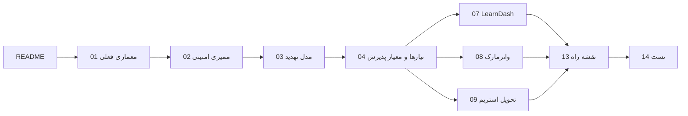

# فهرست مستندات

این پوشه مرجع کامل پروژه است. اگر تازه شروع می‌کنید، ترتیب زیر را رعایت کنید.

## مسیر مطالعه‌ی پیشنهادی

## دو قاعده‌ی نام‌گذاری

- هر مستند دو بخش دارد: **«وضعیت فعلی»** (کد `3.1.0`) و **«طراحی هدف»** (نسخه‌ی بعدی). این دو را قاطی نکنید.
- ارجاع به کد با قالب `falnic-secure-hls.php:L280` نوشته می‌شود؛ شماره‌ی خط مربوط به کامیت `20eeed0` است.

## فایل‌ها

| # | فایل | چه سؤالی جواب می‌دهد |
|---|---|---|
| 01 | [ARCHITECTURE](01-ARCHITECTURE.md) | کد الان چطور کار می‌کند؟ |
| 02 | [SECURITY-AUDIT](02-SECURITY-AUDIT.md) | چه چیزهایی خراب است و چقدر خطرناک؟ |
| 03 | [THREAT-MODEL](03-THREAT-MODEL.md) | از چه کسی و از چه راهی محافظت می‌کنیم؟ |
| 04 | [REQUIREMENTS](04-REQUIREMENTS.md) | «موفقیت» چه شکلی است؟ |
| 05 | [DATA-MODEL](05-DATA-MODEL.md) | داده‌ها کجا ذخیره می‌شوند؟ |
| 06 | [API](06-API.md) | چه اندپوینت‌هایی داریم/خواهیم داشت؟ |
| 07 | [LEARNDASH](07-LEARNDASH.md) | ویدیو چطور داخل درس قرار می‌گیرد؟ |
| 08 | [WATERMARKING](08-WATERMARKING.md) | واترمارک چطور واقعاً کار می‌کند؟ |
| 09 | [STREAM-DELIVERY](09-STREAM-DELIVERY.md) | فایل‌ها چطور بدون لو رفتن سرو می‌شوند؟ |
| 10 | [PLAYER](10-PLAYER.md) | پلیر سمت مرورگر چطور ساخته می‌شود؟ |
| 11 | [INSTALLATION](11-INSTALLATION.md) | چطور نصب و تنظیم شود؟ |
| 12 | [CONFIGURATION](12-CONFIGURATION.md) | چه کلیدهایی برای تنظیم وجود دارد؟ |
| 13 | [ROADMAP](13-ROADMAP.md) | قدم بعدی چیست؟ |
| 14 | [TESTING](14-TESTING.md) | چطور مطمئن شویم کار می‌کند؟ |
| 15 | [TROUBLESHOOTING](15-TROUBLESHOOTING.md) | چرا سیاه است / پخش نمی‌شود؟ |
| 16 | [MIGRATION](16-MIGRATION.md) | از نسخه‌ی فعلی چطور مهاجرت کنیم؟ |
| 17 | [ADR](17-ADR.md) | چرا این تصمیم‌ها گرفته شد؟ |
| 18 | [STRUCTURE](18-STRUCTURE.md) | فایل‌ها کجا هستند و چطور کلاس جدید اضافه کنم؟ |
| 19 | [GIT UPDATER](19-GIT-UPDATER.md) | آپدیت امن از گیت‌هاب، پشتیبان، بازگردانی و تست‌ها |
| 20 | [ASYNC ENCODING](20-ASYNC-ENCODING.md) | آپلود فوری، صف WP-Cron، پیشرفت، کیفیت ABR |
| 21 | [WATCH LOG](21-WATCH-LOG.md) | گزارش تماشا، سقف پخش هم‌زمان، «قطع پخش»، زیرنویس |

## اصطلاحات

| اصطلاح | معنی در این پروژه |
|---|---|
| **video key** | شناسه‌ی پایدار و تصادفی هر ویدیو، مثل `v_9f2c1a7b`؛ جای نام پست را می‌گیرد |
| **Rendition** | نسخه‌ی کیفیت مشخص (مثلاً `720p`) با پلی‌لیست و سگمنت‌های خودش |
| **Segment** | تکه‌ی چندثانیه‌ای ویدیو (`.ts`) که پلیر به ترتیب می‌گیرد |
| **Playback token** | توکن کوتاه‌عمر امضاشده با HMAC که اجازه‌ی گرفتن manifest/کلید/سگمنت را می‌دهد |
| **Key rotation** | تعویض دوره‌ای کلید AES در طول ویدیو تا یک کلید لو رفته کل فایل را باز نکند |
| **Forensic watermark** | واترمارکی که شناسه‌ی کاربر را در تصویر می‌نشاند و بعد از لو رفتن قابل ردیابی است |
